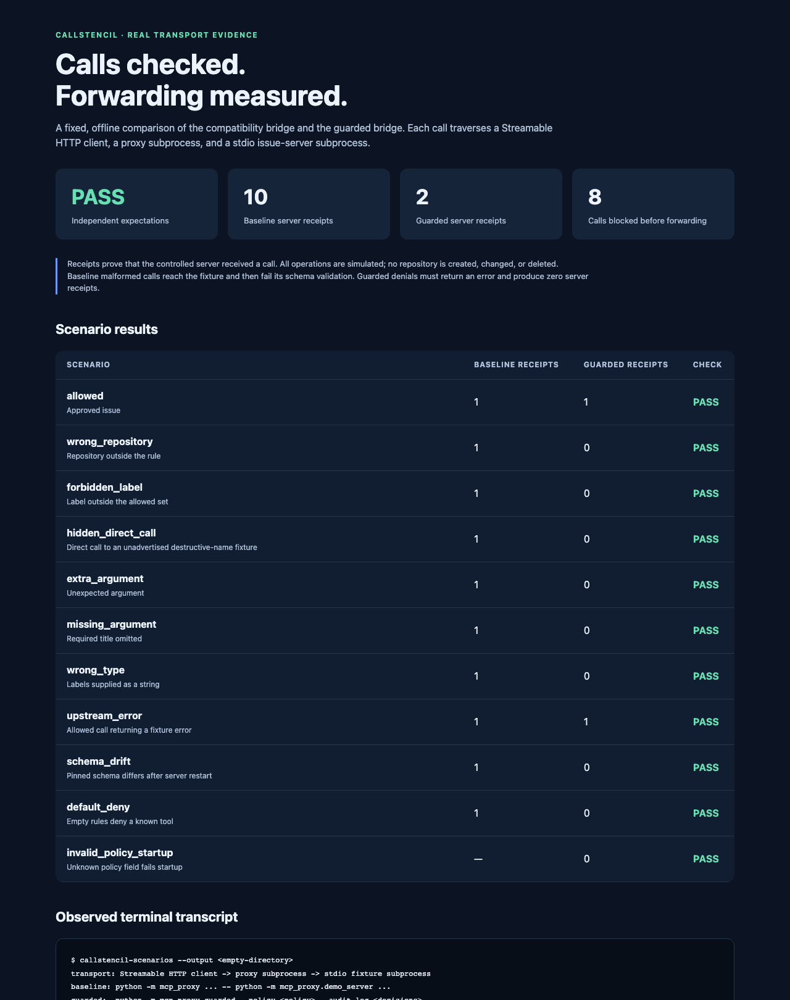
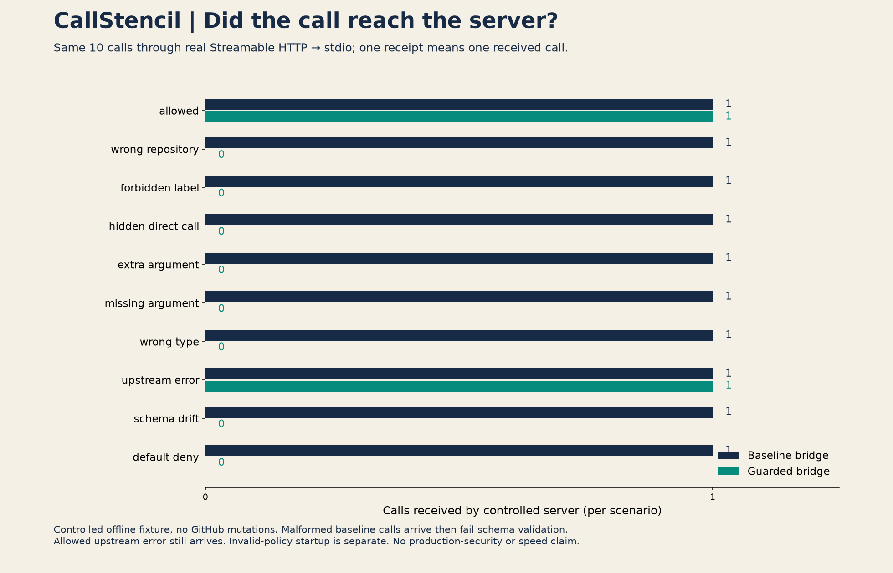
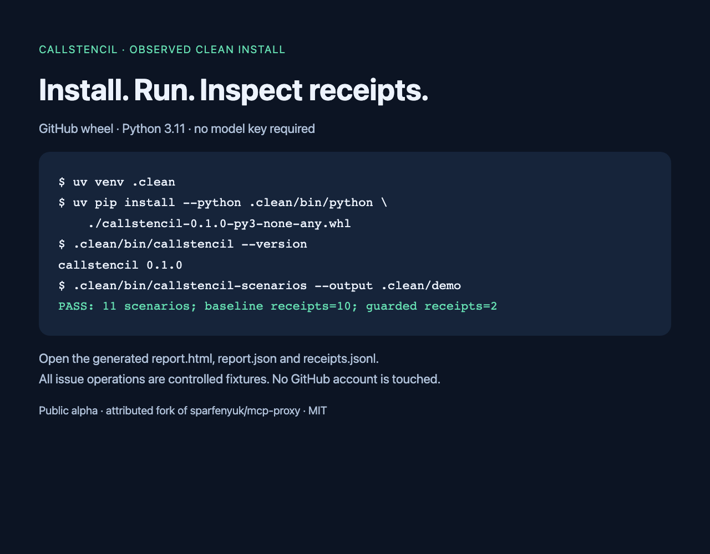

# CallStencil engineering campaign

Derived from `campaign.json`; edit that canonical file and run `python3 campaign/validate.py --render`.

Prepared: True. Scheduled: False. Published: False.
Release claims: pending_public_release_readback. Ready for scheduling: False.

Prepared copy only. No publishing or scheduling action has been performed. Release availability claims require public release readback.

All copy is English. Each beat's audience, hook, evidence, CTA, image and alt text apply to both platform items below. The X copy is adapted into threads rather than truncated from LinkedIn.

CallStencil is an MIT-licensed attributed fork of sparfenyuk/mcp-proxy by Sergey Parfenyuk and contributors, baseline 701a0453487d1b28c8f9806ee4863674c70210dd. Bridging is retained upstream capability; per-call policy is related prior art, not a category novelty claim.

Posting order: problem → design tradeoff → reproducible demo → fair experiment → release quickstart. No account, queue, date or schedule has been assigned.

## 01-problem: Connection is not permission

Audience: Engineers connecting agents to MCP tools

Hook: A working tool connection answers a transport question. It leaves the permission question open.

Evidence: `../README.md`, `../docs/POLICY.md`, `../evidence/demo/report.json`

CTA: Inspect the hidden_direct_call scenario and ask where your own call boundary lives.

Image: `assets/connection-is-not-permission.png` (generated_concept).

Alt text: Conceptual cut-paper illustration: abstract cards approach a navy stencil gate; a matching teal card passes through. Text reads 'CallStencil' and 'Connection is not permission.'

### LinkedIn — 1078 characters

A working tool connection answers a transport question. It leaves the permission question open.

Suppose an agent may create an issue in one repository with a small set of labels. Making create_issue discoverable doesn't express that rule. Hiding another tool from discovery doesn't prove a direct call will be refused either.

CallStencil puts an explicit policy check before forwarding tools/call: exact tool name, required arguments, allowed values and a reviewed input-schema fingerprint. Unmatched calls deny. Discovery filtering helps the client, but the call path carries the enforcement.

The offline fixture includes a direct call to an unadvertised tool. The unguarded bridge forwards it; the guarded bridge produces no server receipt. This is a controlled receipt experiment, not a real destructive operation.

CallStencil is an attributed fork of Sergey Parfenyuk and contributors' mcp-proxy. Its useful transport bridge comes from upstream.

Inspect the hidden_direct_call scenario and ask where your own call boundary lives:
https://github.com/grishahq/callstencil

### X thread

Post 1 — 178 weighted characters

1/4 A working MCP connection answers "can I reach this tool?" A useful next question is "may this exact call pass?" Repository and label restrictions belong at the call boundary.

Post 2 — 207 weighted characters

2/4 Discovery is useful UX, but hiding a tool doesn't prove direct calls are refused. CallStencil's offline fixture includes a direct call to an unadvertised tool: the guarded path records no server receipt.

Post 3 — 208 weighted characters

3/4 CallStencil checks exact tool names, arguments and pinned input schemas before forwarding tools/call. It is an attributed fork of mcp-proxy by Sergey Parfenyuk and contributors; bridging is upstream work.

Post 4 — 192 weighted characters

4/4 Inspect hidden_direct_call in the recorded demo. The fixture records receipt, never a real repository deletion. Where is the equivalent boundary in your tool setup?
https://github.com/grishahq/callstencil

## 02-design: Small rules, explicit tradeoffs

Audience: Platform engineers reviewing MCP policy design

Hook: A permission rule should be small enough to review and strict enough to fail closed.

Evidence: `../docs/POLICY.md`, `../README.md`, `../ATTRIBUTION.md`

CTA: Review the policy reference and try a deny-all policy before adding one narrow rule.

Image: `assets/test-the-boundary.png` (generated_concept).

Alt text: Conceptual engineering workbench in ivory, navy, teal and coral: a stencil checks cards beside a receipt roll. Text reads 'CallStencil' and 'Test the boundary'.

### LinkedIn — 1251 characters

A permission rule should be small enough to review and strict enough to fail closed.

CallStencil v1 uses exact tool names, required argument keys and explicit constraints. For the issue fixture, a rule can require one repository and limit every label to an approved set. Unknown argument keys deny. An empty rules array is a valid deny-all policy.

There is another piece to review: the server's input schema. Each rule pins its SHA-256 fingerprint. A fresh schema lookup on every call lets the bridge reject a changed or unavailable schema before forwarding.

That choice costs a round trip and may expose compatibility problems. It also has a clear limit: a schema fingerprint cannot establish that a server's implementation behaves as advertised. Pin and review the server build too; lookup and forwarding are separate operations.

This stays deliberately narrow: one stdio server exposed over HTTP or SSE, with policy enforcement on tools/call. It provides no OS sandbox or caller-identity binding.

The transport foundation is mcp-proxy, credited in the repository. Per-call policy has existing prior art.

Read the policy reference and try deny-all before adding one narrow rule:
https://github.com/grishahq/callstencil/blob/main/docs/POLICY.md

### X thread

Post 1 — 205 weighted characters

1/4 A small policy is easier to review. CallStencil v1 uses exact tool names, required argument keys and explicit value constraints. Unknown argument keys deny. An empty rules array denies every tool call.

Post 2 — 215 weighted characters

2/4 Each rule pins the reviewed input schema's SHA-256 fingerprint. A fresh lookup on every call rejects changed or unavailable schemas before forwarding. The cost is another round trip and a compatibility tradeoff.

Post 3 — 199 weighted characters

3/4 A schema digest can't prove server behavior. Review and pin the server build too. Scope is narrow: tools/call for one stdio server exposed over HTTP/SSE. No OS sandbox or caller-identity binding.

Post 4 — 180 weighted characters

4/4 Start with deny-all, then add one narrow rule. Review the policy language and its limits. CallStencil builds on the credited mcp-proxy transport bridge.
https://github.com/grishahq/callstencil/blob/main/docs/POLICY.md

## 03-demo: Follow the call to a receipt

Audience: Developers who want a reproducible tool-permission demo

Hook: A denial message is useful. An independent server receipt answers a different question: did the call arrive?

Evidence: `../evidence/demo/report.json`, `../evidence/demo/report.html`, `../README.md`

CTA: Run the local fixture and compare decisions.jsonl with receipts.jsonl.

Image: `assets/demo-report.png` (software_capture).

Alt text: Browser capture of the actual CallStencil offline demo report, showing passing scenario checks and baseline versus guarded server receipts.

### LinkedIn — 1254 characters

A denial message is useful. An independent server receipt answers a different question: did the call arrive?

CallStencil's demo runs a real subprocess stdio server behind a Streamable HTTP bridge on loopback. The server is a controlled issue fixture. No model key, external account or GitHub mutation is involved.

The runner exercises 11 scenarios: an approved issue, wrong repository, forbidden label, a hidden direct call, malformed arguments, schema drift, deny-all, a server error and invalid policy startup. The recorded run passes its receipt and error assertions.

Follow one case through the files: the wrong-repository call gets a receipt through the unguarded bridge, and zero receipts through the guarded bridge. Then inspect upstream_error: it passes policy and reaches the fixture, which returns an error. Authorization passed; execution did not succeed.

That distinction is why the report includes both decision records and server receipts. A green authorization record is not an application success claim.

The bridge is an attributed mcp-proxy fork. The added fixture and runner make this particular boundary inspectable.

Run the local fixture, then compare decisions.jsonl with receipts.jsonl:
https://github.com/grishahq/callstencil

### X thread

Post 1 — 220 weighted characters

1/4 A denial message and a server receipt answer different questions. CallStencil's offline demo compares both across a real Streamable HTTP bridge and a subprocess stdio fixture. No model key or external account needed.

Post 2 — 183 weighted characters

2/4 The recorded run passes 11 scenarios. Wrong repository: baseline receipt 1, guarded receipt 0. The fixture never creates GitHub issues; a receipt means the forwarded call arrived.

Post 3 — 215 weighted characters

3/4 The upstream_error case matters: policy allows the call, the fixture receives it, then returns an error. Authorization success and application success are separate facts. Inspect decisions and receipts together.

Post 4 — 199 weighted characters

4/4 Reproduce the fixture locally and inspect report.json, decisions.jsonl and receipts.jsonl. CallStencil is an attributed mcp-proxy fork; the report is a bounded experiment.
https://github.com/grishahq/callstencil

## 04-experiment: Read the receipt comparison fairly

Audience: Engineers assessing evidence and experiment limits

Hook: 10 baseline receipts. 2 guarded receipts. The useful part is what those numbers mean.

Evidence: `../evidence/demo/report.json`, `../README.md`, `../docs/POLICY.md`

CTA: Inspect the per-scenario observations instead of treating aggregate counts as a security score.

Image: `assets/receipts-comparison.png` (data_visualization).

Alt text: Chart derived from the recorded offline demo: 10 baseline receipts, 2 guarded receipts and 8 blocked call attempts. Receipt totals describe fixture arrival, not real repository mutations.

### LinkedIn — 1371 characters

10 baseline receipts. 2 guarded receipts. The useful part is what those numbers mean.

The CallStencil demo compares the unguarded bridge with the guarded bridge using controlled scenarios and an independent fixture receipt log. Eight call attempts that reach the baseline fixture produce zero guarded receipts. The approved call and an allowed call that returns a fixture error account for the two guarded receipts.

An important detail: the fixture writes its receipt before validating arguments. Some baseline calls therefore have a receipt AND an error. Ten receipts do not mean ten successful operations, and no real repository is modified.

The 11th scenario tests malformed policy startup. It has no baseline call; the guarded process fails before a server call occurs. Read its startup assertion separately from the ten paired call cases.

These are deterministic local checks of selected policy paths. They are not production coverage, a latency benchmark, or proof about every server. A pinned schema detects declared changes; it cannot attest to implementation semantics.

CallStencil retains mcp-proxy's transport work with explicit attribution. The contribution here is a narrow, reproducible policy experiment.

Inspect the per-scenario observations before interpreting the totals:
https://github.com/grishahq/callstencil/blob/main/evidence/demo/report.json

### X thread

Post 1 — 215 weighted characters

1/5 The CallStencil fixture recorded 10 baseline receipts and 2 guarded receipts. Eight call attempts reached the unguarded fixture and produced zero guarded receipts. These are receipt counts, not a security score.

Post 2 — 177 weighted characters

2/5 The fixture writes a receipt BEFORE argument validation. A baseline call can have both a receipt and an error. No real repository is modified. Arrival is the measured event.

Post 3 — 177 weighted characters

3/5 The two guarded receipts are an approved call and an allowed call returning a fixture error. The 11th scenario checks invalid-policy startup; it has no paired baseline call.

Post 4 — 211 weighted characters

4/5 Limits: selected deterministic local scenarios, no production coverage or latency claim. Schema pinning detects declared schema changes, not silently changed server behavior. Inspect individual observations.

Post 5 — 161 weighted characters

5/5 The full report is checked in. Reproduce it and challenge the assumptions. CallStencil builds on mcp-proxy with explicit attribution.
https://github.com/grishahq/callstencil/blob/main/evidence/demo/report.json

## 05-release: A quickstart that leaves evidence

Audience: Python and MCP developers evaluating the alpha

Hook: A useful alpha quickstart should leave files you can inspect, not just a success message.

Evidence: `../README.md`, `../ATTRIBUTION.md`, `../evidence/demo/report.json`

CTA: Follow the repository quickstart in a fresh environment and inspect the generated report.

Image: `assets/release-quickstart.png` (software_capture).

Alt text: Actual clean-install CallStencil quickstart output for v0.1.0, with the scenario command and successful evidence report generation.

### LinkedIn — 1262 characters

A useful alpha quickstart should leave files you can inspect, not just a success message.

CallStencil's local walkthrough ends with an HTML report, JSON observations, server receipts, decision records and a transcript. Run callstencil-scenarios and inspect the allowed call, a denied argument, the hidden direct call and the allowed fixture error side by side.

The source quickstart uses Python 3.10+ and uv. Use a fresh environment: CallStencil is an attributed fork of mcp-proxy and retains the mcp_proxy module, so the distributions should not be co-installed.

For the guarded bridge, callstencil requires an explicit valid policy. The compatibility mcp-proxy command remains available; without --policy it forwards without CallStencil enforcement. That distinction belongs in the quickstart, where it can prevent a misleading test.

The alpha scope is tools/call policy for a stdio server exposed over HTTP or SSE. It does not protect direct server access or supply an OS sandbox.

Start with the controlled fixture, read the policy reference, and report a minimal reproduction if the observed boundary differs from the documented one.

Follow the quickstart in a fresh environment and inspect the generated report:
https://github.com/grishahq/callstencil

### X thread

Post 1 — 213 weighted characters

1/4 A useful alpha quickstart leaves evidence. CallStencil's local runner writes an HTML report, JSON observations, server receipts, decision records and a transcript. Inspect the boundary, not just the exit code.

Post 2 — 176 weighted characters

2/4 Start in a fresh environment with Python 3.10+ and uv. CallStencil is an attributed mcp-proxy fork and retains the mcp_proxy module; don't co-install the two distributions.

Post 3 — 202 weighted characters

3/4 The callstencil command requires a valid policy. The compatibility mcp-proxy command without --policy has no CallStencil enforcement. v0.1 scope: tools/call for a stdio server exposed over HTTP/SSE.

Post 4 — 180 weighted characters

4/4 Follow the source quickstart, run the offline fixture and inspect its report. Report minimal policy/server/schema reproductions for unexpected behavior.
https://github.com/grishahq/callstencil
